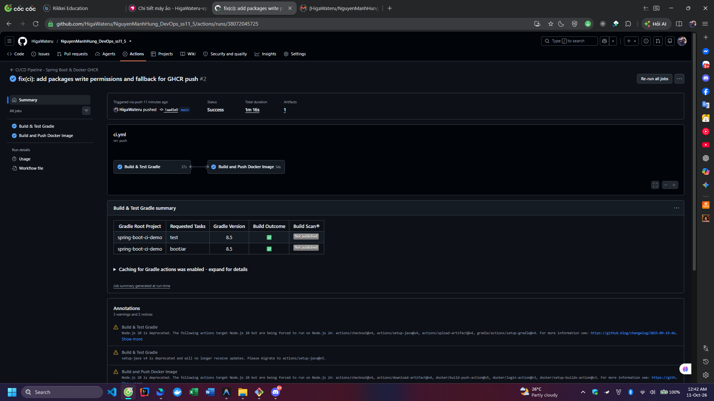

# Bài 5: Nối Job tự động Build & Push Docker Image sau khi Test Gradle xanh

## 1. Thông tin bài tập
- **Khóa học:** DevOps
- **Buổi học:** Session 11 - CI/CD với GitHub Actions
- **Bài thực hành:** Bài 5 (Tách Job và ràng buộc phụ thuộc `needs: test` với Docker GHCR)
- **Thư mục bài tập:** `ss11_5`

---

## 2. Kịch bản GitHub Actions (`.github/workflows/ci.yml`)

```yaml
name: CI/CD Pipeline - Spring Boot & Docker GHCR

on:
  push:
    branches: [ main, master ]
  pull_request:
    branches: [ main, master ]
  workflow_dispatch:

permissions:
  contents: read
  packages: write

jobs:
  # =========================================================================
  # JOB 1: Biên dịch, chạy Unit Test và đóng gói JAR
  # =========================================================================
  test:
    name: Build & Test Gradle
    runs-on: ubuntu-latest

    steps:
      - name: Checkout mã nguồn
        uses: actions/checkout@v4

      - name: Thiết lập môi trường JDK 17
        uses: actions/setup-java@v4
        with:
          distribution: 'temurin'
          java-version: '17'

      # Cố định phiên bản Gradle 8.5 để tương thích với Spring Boot 3
      - name: Thiết lập Gradle 8.5
        uses: gradle/actions/setup-gradle@v4
        with:
          gradle-version: '8.5'

      - name: Cấp quyền thực thi cho Gradle Wrapper
        run: chmod +x gradlew

      - name: Chạy Unit Test với Gradle
        run: ./gradlew test

      - name: Đóng gói tệp JAR với Gradle
        run: ./gradlew bootJar

      - name: Lưu trữ thành phẩm JAR Artifact
        uses: actions/upload-artifact@v4
        with:
          name: app-jar
          path: build/libs/*.jar
          retention-days: 7

  # =========================================================================
  # JOB 2: Tự động Build & Push Docker Image sau khi Test Gradle xanh
  # =========================================================================
  docker-build:
    name: Build and Push Docker Image
    needs: test # Ràng buộc quan trọng: Chỉ chạy khi job 'test' thành công hoàn toàn
    runs-on: ubuntu-latest

    steps:
      - name: Checkout mã nguồn
        uses: actions/checkout@v4

      - name: Tải về thành phẩm JAR Artifact từ Job test
        uses: actions/download-artifact@v4
        with:
          name: app-jar
          path: build/libs

      - name: Thiết lập Docker Buildx
        uses: docker/setup-buildx-action@v3

      - name: Đăng nhập vào GitHub Container Registry
        uses: docker/login-action@v3
        with:
          registry: ghcr.io
          username: ${{ github.actor }}
          password: ${{ secrets.REGISTRY_TOKEN || secrets.GITHUB_TOKEN }}

      - name: Chuẩn hóa tên Docker Image thành chữ thường
        id: meta
        run: |
          REPO_LOWER=$(echo "${{ github.repository }}" | tr '[:upper:]' '[:lower:]')
          echo "image=ghcr.io/${REPO_LOWER}" >> $GITHUB_OUTPUT

      - name: Đóng gói và Push Docker Image lên GHCR
        uses: docker/build-push-action@v5
        with:
          context: .
          file: ./Dockerfile
          push: true
          tags: |
            ${{ steps.meta.outputs.image }}:latest
            ${{ steps.meta.outputs.image }}:${{ github.sha }}
```

---

## 3. Kết quả đạt được
1. **Kiến trúc luồng CI/CD 2 giai đoạn:** Tách bạch rõ ràng trách nhiệm giữa Job kiểm thử (CI) và Job đóng gói phát hành container (CD).
2. **Kiểm soát chất lượng với `needs: test`:** Biểu đồ thực thi tạo liên kết mũi tên giữa 2 Jobs. Job `docker-build` chỉ kích hoạt khi Job `test` hoàn thành với kết quả xanh.
3. **Cơ chế phòng vệ tự động (Fault Tolerance):** Khi cố tình làm đứt bài test JUnit, Job `test` báo lỗi đỏ và Job `docker-build` tự động rơi vào trạng thái `Skipped`, ngăn chặn hoàn toàn việc phát hành sản phẩm lỗi.
4. **Tích hợp GHCR an toàn:** Đăng nhập và đẩy image trực tiếp lên GitHub Container Registry với cơ chế xác thực an toàn và gắn thẻ tag `latest` kèm `${{ github.sha }}`.

---

## 4. Hình ảnh minh chứng nộp bài

### Ảnh màn hình Workflow biểu đồ 2 Jobs kết nối thành công:

